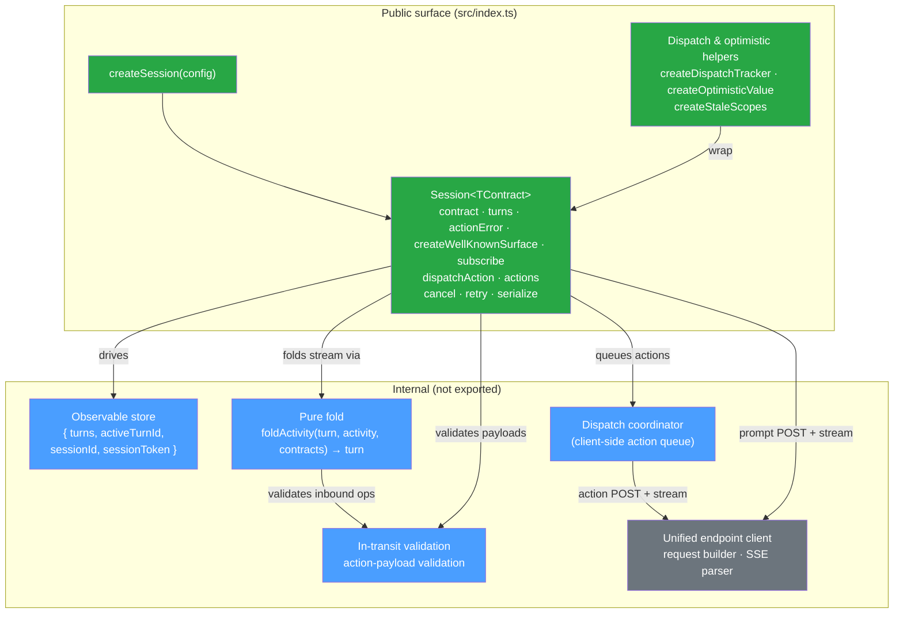
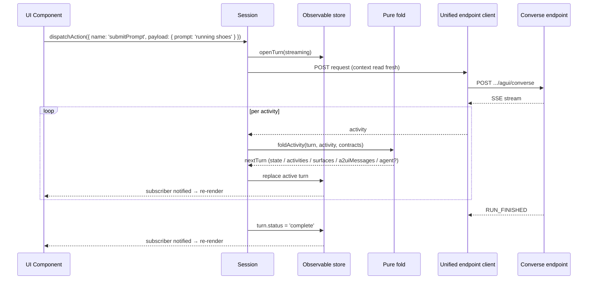

# Architecture Guide

This document explains how the `@coveo/thermidor` library is structured, why each part exists, and how they connect. It is written for Coveo engineers; Coveo context (org IDs, access tokens, the unified converse endpoint) is assumed.

The decisions of record are the accepted ADRs [ADR-009](./internal/adr/ADR-009-architecture-decision-charter-v2.md) (charter v2) through [ADR-016](./internal/adr/ADR-016-inline-state-consumption-remove-remote-controller.md). This guide describes the **shipped** architecture; it supersedes the earlier engine/interface/Redux/facade description.

## The core idea

`@coveo/thermidor` is a lean client for a single, stateful, intent-routing **unified converse endpoint**. The server streams its response over AG-UI SSE — conversational messages, reasoning steps, and tool calls, alongside schema-defined A2UI components — and the client renders what the server sends. Thermidor transmits consumer input, folds the streamed result into an observable list of `Turn`s, and validates component state and actions against a consumer-injected contract — nothing more. Component state travels inline through the A2-UI data model (`/state/<id>` `updateDataModel` operations); renderers read it through `{ path }` bindings, and every action goes through the single `session.dispatchAction` entry point ([ADR-016](./internal/adr/ADR-016-inline-state-consumption-remove-remote-controller.md)).

Everything the previous revision described (an `Engine` class, a library-agnostic `interface/` layer, Redux Toolkit slices, per-endpoint facades) has been **removed wholesale** ([ADR-010](./internal/adr/ADR-010-unified-endpoint-session-client.md)). The current package has no engine, no interface layer, no Redux/RTK, and no facades.

## Public surface

The package entry (`src/index.ts`) exports the session-client surface — `createSession`, the `Session` handle, the `Turn` / `TurnResponse` domain model (including `A2uiV09Message` and `DiscoveredSurface`), `SessionConfig`, the injected-contract types (`ContractsSchema`, `ComponentContractSchema`, `ParsableSchema`), the client-owned context types, and the versioned `SerializedSession` shape. It also exports the client-side dispatch helpers (`createDispatchCoordinator`, `createSettledDispatch`, `createDispatchTracker`, `SessionActions`), which are scoped for removal once the producer owns the action queue, and the optimistic-update helpers (`createOptimisticValue`, `createStaleScopes`). It is intentionally free of state-library concepts (no store, slice, selector, thunk, or reducer types) and free of raw transport DTO shapes; `src/index.test-d.ts` fails the typecheck if one leaks into the entry.



## Package structure

```
src/
├── index.ts                       # Public surface (ADR-010 / ADR-014 / ADR-016)
├── session/
│   ├── create-session.ts          # createSession factory + runtime (dispatch/cancel/retry)
│   ├── conflict-retry.ts          # Bounded retry of 409 AGENT:ACTION_IN_FLIGHT rejections
│   ├── types.ts                   # Turn / TurnInput / TurnResponse domain model (ADR-010 model annex)
│   ├── store.ts                   # Plain observable store + subscribe/notify
│   ├── fold.ts                    # Pure fold + surface derivation (ADR-015 interim)
│   ├── a2ui-v09-projection.ts     # A2-UI v1.0 → v0.9 renderer projection (ADR-015 addendum)
│   ├── contracts.ts               # Structural type of the injected contract bundle (ADR-014, ADR-017)
│   ├── in-transit-validation.ts   # Validates inbound updateDataModel ops against *State schemas
│   ├── resolve-operation.ts       # Maps an op path to a component's whole state or a field beneath it
│   ├── action-payload-validation.ts # Validates outbound action payloads before the POST
│   ├── state-path.ts              # /state/<id> JSON Pointer helpers
│   ├── well-known-surfaces.ts     # Instances of the contract's well-known surface templates (ADR-017)
│   └── serialize.ts               # Versioned serialize / restore (ADR-011)
├── actions/                       # Client-side dispatch coordinator + tracker (scoped for removal)
├── optimistic/                    # Optimistic value controller + stale scopes
└── internal/
    ├── api/                       # Unified endpoint client, request builder, SSE parser
    ├── context/                   # Navigator / commerce context types
    └── utils/                     # id generation, dev-only warnings
```

## The session factory and runtime

`createSession(config)` (`src/session/create-session.ts`) builds a fresh observable store and returns a `Session`. There are no singletons and no module-level mutable state: two sessions created from identical configuration share nothing mutable ([ADR-009](./internal/adr/ADR-009-architecture-decision-charter-v2.md), charter conformance).

The runtime owns the dispatch / cancel / retry orchestration and the SSE-consumption loop that folds each event into the active turn:

- **`dispatchAction(message)`** — the single consumer-facing entry point, wired as the renderer's `onAction`. It never rejects: every refusal is a dev-only warning.
  - A `submitPrompt` action (`{name: 'submitPrompt', payload: {prompt}}`) needs no active turn. It withholds queued component actions, cancels a stream in flight, opens a new `streaming` turn, builds a request (invoking both context providers fresh), POSTs to the endpoint, and folds the streamed response into that turn.
  - An A2-UI client message is unwrapped to its `userAction`. The runtime recovers the dispatching component's `component` discriminant from the active turn's node-identity registry (derived from its activities), validates the payload against that component's action schema, and queues the action for its own originating surface. It is withheld while a turn is streaming, when there is no active turn, when the node resolves to no component, or when the payload fails validation. The action's response streams into the active turn.
  - An A2-UI client message from a live well-known surface instance is resolved against the instance instead, and must be one the contract marks as a lookup. It is sent at once in a lane of its own, with the template name as `surfaceTemplate`, and a newer lookup from the same surface, component and action aborts it. Its run is applied to the live instances only: it never touches a turn or the session keys ([ADR-017](./internal/adr/ADR-017-well-known-surfaces-and-lookups.md)).
- **`createWellKnownSurface(template, options?)`** — creates an instance of a template the contract declares, outside any turn, whose `messages` hold its creation at once and then each lookup result, validated in transit. Disposing of it aborts its lookups. Instances are never serialized.
- **`cancel()`** — stops consuming the in-flight stream. A streaming prompt turn keeps the partial `response` already folded and is marked `error` with the message `'Cancelled'`; an action in flight settles `'cancelled'` and leaves its turn as it was. A no-op when nothing is in flight.
- **`retry(turnId)`** — re-submits only an `error` turn's original input; any other `turnId` (unknown, or non-error) is a no-op.

Component actions reach the endpoint through one per-session dispatch coordinator (`src/actions/dispatch-coordinator.ts`): a FIFO with at most one action in flight, which coalesces queued gestures by their declared `CoalesceIntent`, and which a prompt preempts (queued entries `withheld`, the in-flight one `cancelled`). It is in memory only and never serialized. See the README's "The action queue" for the integrator-facing rules.

Every request, prompt or action, is sent through a bounded retry loop (`src/session/conflict-retry.ts`, called from `executeStream`): while the Gateway answers `409` with the `errorCode` `AGENT:ACTION_IN_FLIGHT` (parsed in `src/internal/api/protocol/error-handling.ts`), the request is rebuilt and resent after a doubling backoff, for up to 30 s in total (the time spent on each rejected request included), each wait capped at 4 s and the last one cut to what is left. The budget covers an aborted agent run winding down on the Gateway, which can't cancel it upstream yet (KIT-6261). A request sent the moment `RUN_FINISHED` arrives can get a 409 too, because the Gateway commits the turn a few milliseconds later; the first retry absorbs it. The retrying action stays in flight in the coordinator, so the queue behind it keeps its order and nothing touches the turn. When the budget runs out, a prompt fails its turn; an action sets the session-level `actionError` and settles `'failed'`, which releases its optimistic hold. The wait is abortable, so a preempting prompt or `cancel()` ends it like a stream; an abort during a resent request is handled the same way, since the client reports it as a failed call rather than throwing it. `executeStream` returns a request rejected before streaming to its caller, so the prompt path fails its turn while the action path sets `actionError` (cleared when the next action or prompt is sent).

The runtime holds the in-flight stream's `AbortController` per session instance — never module-level — so two sessions never contend, and a stream superseded by a newer one never touches the turn.

Cancellation is modeled as a terminal `error` turn (message `'Cancelled'`), not a distinct status. A cancelled turn and a failed turn share every lifecycle property — both are terminal, non-streaming, retryable, and preserve their partial `response` — so no runtime branch distinguishes them, and adding a separate `cancelled` status would only widen `TurnStatus` without changing behavior. Consumers that need to tell a user-initiated stop from a genuine failure should not string-match the message; if that distinction is ever required, prefer a structured discriminator (e.g. an error `reason`) over a new status.

## The observable store

`src/session/store.ts` holds `{ turns, activeTurnId?, sessionId?, sessionToken? }`. It exposes `getState`, an internal setter that notifies on change, and `subscribe(listener) → unsubscribe`. Every registered subscriber is notified exactly once per change. This plain store replaces the former RTK slice plus state port ([ADR-010](./internal/adr/ADR-010-unified-endpoint-session-client.md) structure annex); there is no Redux state library anywhere in the package.

## The pure fold

`src/session/fold.ts` exposes `foldActivity(previousTurn, activity, contracts?) → nextTurn` — the single place a `TurnResponse` is constructed from the stream. It is a pure reduction: the injected `contracts` is a bound dependency, never turn state, and folding the same activity sequence twice with the same contracts yields deeply-equal turns.

The fold maps each SSE activity into the active turn's `response`:

- Text-message events accumulate into `response.agent.messages` (the `agent` facet is created lazily, signaling the router invoked an agent).
- Reasoning and tool-call events accumulate into `response.agent.reasoningSteps`.
- `ACTIVITY_SNAPSHOT` events append to `response.activities` (a `replace` snapshot merges onto the activity with the same `messageId`), re-derive `response.surfaces` and `response.a2uiMessages` from the full activity list, and apply the snapshot's `updateDataModel` ops to `response.state` after in-transit validation.
- Terminal events (`RUN_FINISHED` / `turn_complete`, `RUN_ERROR`) set `status` to `complete` or `error`.

## The Turn / TurnResponse domain model

`src/session/types.ts` defines the canonical runtime model ([ADR-010](./internal/adr/ADR-010-annex-model.md) model annex):

```typescript
interface Turn {
  id: string;
  input: {prompt?: string}; // omitted for a prompt-less action turn
  response: TurnResponse;
  status: 'streaming' | 'complete' | 'error';
  error?: string; // present iff status === 'error'
}

interface TurnResponse {
  state: A2uiState; // validated component state (/state/<id> ops) per surface, defaults to {}
  activities: Activity[]; // raw snapshot log, latest snapshot per messageId, defaults to []
  surfaces: DiscoveredSurface[]; // typed projection derived from activities
  a2uiMessages: A2uiV09Message[]; // renderer-ready v0.9 stream derived from activities
  agent?: {messages: AgentMessage[]; reasoningSteps: ReasoningStep[]};
}
```

`state` and `activities` are routing-neutral and always present. Only `messages` and `reasoningSteps` are agent-specific; they live under the optional `agent` facet, whose presence signals "the router invoked an agent". Consumers read `turn.input.prompt`, `turn.response.a2uiMessages` (to feed a renderer), `turn.response.surfaces`, and `turn.response.agent?.*`; `state` and `activities` remain available.

## Validation

The injected contracts schema is validated against at two boundaries, both inside the core, so a consumer never runs Zod ([ADR-016](./internal/adr/ADR-016-inline-state-consumption-remove-remote-controller.md)):

- **Inbound state** (`src/session/in-transit-validation.ts`) — each `updateDataModel` op is resolved to its component through the node-identity registry and validated in transit: a whole-component op (`/state/<id>`) against the component's `*State` schema, a partial op against the sub-schema at its path. A conforming op is applied to `response.state`. An op whose path is outside `/state/<id>` of a present component (for example `/isLoading` or `/`) is dropped as `unresolved-path`, and a non-conforming one is dropped too, so the previous value stays. `createSurface.dataModel` is never read into `response.state`.
- **Outbound actions** (`src/session/action-payload-validation.ts`) — an action's payload is validated against the component's action schema before the POST; a non-conforming one is withheld.

`response.a2uiMessages` is derived from the raw activities, not from `response.state`, so a renderer fed from it receives every inbound op, including those in-transit validation drops, and the component state seeded by `createSurface.dataModel`, which is never validated (see [Recorded interim debt](#recorded-interim-debt-and-out-of-scope-items)).

## Action queue and optimistic updates

Component actions go through one per-session dispatch coordinator (`src/actions/`, exposed as `session.actions`), described in [The session factory and runtime](#the-session-factory-and-runtime). `createDispatchTracker(session.actions)` wraps it for a renderer: it issues each dispatch with the coalescing intent its gesture declared and tracks which consumer-named regions the gesture makes stale until it settles (`src/optimistic/stale-scope.ts`).

`createOptimisticValue` (`src/optimistic/optimistic-value.ts`) holds a control's intended value while its gesture is outstanding and ignores the producer's value meanwhile, then lets the producer win once the last gesture settles. A gesture declares its action, the value it expects (`next`), its `coalesce` policy, and the regions it `invalidates`.

The coordinator, the dispatch tracker, `session.actions`, and the coalescing part of the optimistic controller are scoped for removal once the producer owns the action queue; stale scopes are not.

## Injected schema, endpoint, and context

- **Contracts schema** ([ADR-014](./internal/adr/ADR-014-consumer-supplied-endpoint-and-schema.md)) — `config.contract.components` is the sole source for component-state and action-payload validation; the same bundle carries the well-known surface templates and the lookup actions (ADR-017). The package declares no dependency on any specific schema package; it accepts any Zod discriminated union on `component` through a structural type (`src/session/contracts.ts`) that reads only public Zod API. `zod` is a peer dependency spanning both majors (`3.25.76 || ^4`), so validation runs through the single `zod` instance resolved by the injected schema. A consumer whose renderer is built on Zod 3 injects a Zod 3 schema.
- **Endpoint** — when `endpoint` is provided the client POSTs to it verbatim (nothing appended); when absent it resolves `https://{orgId}.org.coveo.com` and appends the fixed converse path `/api/preview/organizations/{orgId}/agents/commerce/agui/converse`. A missing/empty org fails before any network call.
- **Context providers** ([ADR-012](./internal/adr/ADR-012-client-owned-context.md)) — `navigatorContextProvider` and `commerceContextProvider` are synchronous and read fresh per request in the request builder. An absent commerce provider sends the structural-empty "absent" encoding (`cart: []`, no `pinnedProducts`/`source`/`custom`); a present-but-empty provider sends `cart: []` distinguishably. Context is never serialized, so a restored session reads today's context from the providers.

## Serialization and restoration

`src/session/serialize.ts` ([ADR-011](./internal/adr/ADR-011-session-serialization.md)) defines a versioned `SerializedSession` (integer `version >= 1`), intentionally distinct from the runtime `Turn` type:

| Field                                       | Persisted | Scope            |
| ------------------------------------------- | --------- | ---------------- |
| `id`, `input`, `status`, `error`            | yes       | all turns        |
| `sessionId`, `sessionToken`, `activeTurnId` | yes       | session-level    |
| `response.activities`                       | yes       | all turns        |
| `response.agent.{messages,reasoningSteps}`  | yes       | turns with agent |
| `response.state`                            | yes       | active turn ONLY |
| `response.surfaces`                         | no        | derived          |
| `response.a2uiMessages`                     | no        | derived          |

On restore, `surfaces` and `a2uiMessages` are re-derived from each turn's persisted `activities`; a turn persisted mid-stream (`streaming`) is downgraded to `error` (`'Stream was interrupted'`) preserving its partial response; non-active turns yield an empty `{}` state; an unsupported `version` is rejected without partially populating a session. `sessionId` / `sessionToken` are used only as continuity keys to continue the same backend conversation.

### Active-turn state scope

`response.state` is persisted for the active turn only, because actions resolve against the active turn alone. A restored earlier turn still renders: its `a2uiMessages`, data model included, is re-derived from its persisted `activities`.

## Surface derivation (ADR-015 — recorded interim debt)

`response.surfaces` is a typed projection of `activities`, so no consumer walks raw activities to discover surfaces. Derivation is confined to a single location in `fold.ts` (`deriveSurfaces`). The core interprets no root component type: a consumer reads `rootComponentType` (for example, to pick a loading placeholder). The raw-activity traversal is recorded interim debt per [ADR-015](./internal/adr/ADR-015-surface-and-route-derivation.md); it persists until server-surfaced typed routing lands (ADR-015 Option C, a separate future ADR). Because `surfaces` is derived (never persisted), dropping it and recomputing from `activities` reproduces a deeply-equal list.

Derivation follows the A2-UI surface lifecycle in stream order: `deleteSurface` removes a surface from the list, and a re-created surface moves to the end. Each `DiscoveredSurface` also carries `isLoading`, read from the surface's effective data model (`createSurface.dataModel`, then any `updateDataModel` at `/`, with no path, or at `/isLoading`), so a consumer can draw a loading placeholder for its `rootComponentType` until the agent deletes the surface or clears the flag.

### The v0.9 renderer projection

Agent Gateway emits A2-UI v1.0, and every available renderer consumes v0.9. `src/session/a2ui-v09-projection.ts` (`deriveA2uiV09Messages`) derives `response.a2uiMessages` from `activities`:

- it splits each v1.0 `createSurface` into v0.9 `createSurface` + `updateComponents`, forwarding flat nodes byte-for-byte so every `{ path }` binding survives, and drops a `createSurface` without a `catalogId`;
- it emits one `updateDataModel` per key of the inline `dataModel`, at that key's root JSON Pointer (`isLoading` → `/isLoading`; a key already written as a pointer, such as `/state/<nodeId>`, is kept);
- it passes `updateDataModel` and `updateComponents` through, and `deleteSurface` too, except an orphan (`OrphanDeleteFilter`): a delete for a surface created earlier in the turn's stream, or by a superseded version of one of its activities, that is no longer live. A consumer merging turns into one renderer stream would otherwise apply it to an earlier turn's surface with the same id.

It is the single place that rewrites a message envelope, recorded as a charter exception with a retirement condition in the [ADR-015 addendum](./internal/adr/ADR-015-surface-and-route-derivation.md).

## Recorded interim debt and out-of-scope items

These are intentionally **not yet implemented**:

- **Interim `response.surfaces` derivation** from raw activities (ADR-015 interim) — see above.
- **The v0.9 renderer projection** (ADR-015 addendum) — removed in a breaking change once a v1.0-capable renderer exists.
- **The client-side action queue** (`src/actions`, `session.actions`) — removed once the producer owns the queue.
- **Renderer stream bypasses validation** — `response.a2uiMessages` is projected from raw activities, so inbound ops that in-transit validation drops from `response.state` still reach the renderer, and so does the component state seeded by `createSurface.dataModel`, which is never validated. A fix must cover both: filtering only the projected `updateDataModel` ops still lets the seed through without validation.
- **Enforced action-payload typing at the renderer boundary** — per-component action typing is applied by convention rather than at the `dispatchAction` boundary ([ADR-016](./internal/adr/ADR-016-inline-state-consumption-remove-remote-controller.md)).
- **The package rename** — deferred as low-stakes; the package remains `@coveo/thermidor`.

## How a turn flows end-to-end



## Comparison with the previous revision

For engineers who worked with the earlier engine-based package:

| Previous revision                                | Shipped session client                                              |
| ------------------------------------------------ | ------------------------------------------------------------------- |
| `Engine` class (`read` / `subscribe` / `mutate`) | Plain observable store + `createSession` runtime                    |
| `interface/` layer hiding Redux                  | Removed; no state library at all                                    |
| Redux Toolkit slices + reducers                  | Pure `foldActivity` reduction                                       |
| Per-endpoint facades / thunks                    | One unified endpoint client                                         |
| Controllers built from an interface handle       | Resolved props from the A2-UI data model + `session.dispatchAction` |
| `turn.prompt` / `turn.agentResponse.*`           | `turn.input.prompt` / `turn.response.*` (agent under `agent?`)      |
| Bundled schema, layered exports                  | Consumer-injected `contract`, endpoint, and context                 |
